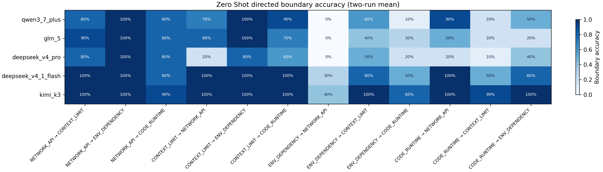

# Agent 开发错误根因分类研究：课程研究报告

## 1. 研究背景与目标

Agent 开发中的报错常跨越应用代码、依赖组件、请求准入和远端服务。异常名称只是故障显现的位置，未必指向最先需要修复的环节。本研究要求模型阅读一段错误情境，按**主要根因**输出唯一标签，而非仅根据 `TimeoutError`、`ValidationError` 等表层名称分类。任务是四分类：

| 标签 | 判定对象 |
|---|---|
| `NETWORK_API` | 网络连接、远端接口或服务通信环节的主要故障。 |
| `CONTEXT_LIMIT` | 输入、输出预留、序列或请求表示达到容量与准入约束。 |
| `ENV_DEPENDENCY` | 依赖、插件、运行环境及跨组件契约缺失或不兼容。 |
| `CODE_RUNTIME` | 在所需环境可用时，应用逻辑、参数、状态或值处理中的运行错误。 |

表中释义按[冻结标签定义](../prompts/label_definitions.txt)概括；实际判题采用该文件全文。研究问题是：五个模型能否在合成的 Agent 错误情境中识别根因，以及加入固定示例后预测如何变化。

## 2. 数据集设计

[Dataset V1](../dataset_v1.csv) 与[正式冻结的 Dataset V2](../dataset_v2.csv) 均有 8 条 Demo、60 条 Test，四类 Test 各 15 条，Demo 四类各 2 条。两版 Demo 的 8 行一致；V2 的 60 条 Test 全部换成 [Challenge Set V4](../experiments/challenge_audit_v1/v4/candidates_full_v4.jsonl) 的候选情境，Test 的 `id`、`error_text` 和 `label` 与 V4 逐条一致。V1 保留为历史基线，正式分析只使用 V2。V2 原始文件 SHA-256 为 `3471f8572b9953f4de7e8a547fad88893265c3f304d7c2fd5fdf5b38afd4876e`；程序使用的 canonical fingerprint 为 `7abb151f8a42bca101465011726ffcf6376fb20523e0dd9cdfc559dacf0610f0`。

V4 按每个 GT 类别配置其余三个类别为 `primary_distractor`，形成 12 个有方向的 GT→干扰类别边界，每个边界恰有 5 条样本。方向表示样本的预设主要混淆对象，并不表示模型一定预测到该类别。设计使用多阶段日志、表示作用域及反事实对照，让表面异常与真实根因可能分离。V4 是**合成设计的候选数据**，不是采集自真实生产环境的错误日志；其中 `source_type` 均为 `SYNTHETIC`。项目方在 V3→V4 中仅修改 T011、T042、T044 的题面，去掉可直接比较的精确测量值与阈值；标签和机制字段保持不变，详见[V4 修订记录](../experiments/challenge_audit_v1/v4/V4_数据修订说明.md)。

前期[Difficulty Pilot V1](../experiments/difficulty_pilot_v1/artifacts/pilot_execution_report_v1.md)在 24 题×3 模型中取得 48 条有效分类及 24 条 DeepSeek 空输出；[Pilot V2](../experiments/difficulty_pilot_v2/artifacts/pilot_execution_report_v2.md)为 DeepSeek 提供足够的生成预算后，72 条均为有效分类。这一阶段用于排查调用配置和运行链路，样本、模型集合及预算协议均不同于后述正式实验，Pilot 准确率不与 V2 Challenge Test 的正式结果合并或比较。

[V4 程序审查](../experiments/challenge_audit_v1/v4/artifacts/audit.md)确认 60 个唯一 ID、四类各 15 条、12 个边界各 5 条，模型输入版本仅含 `id/error_text`，并重新执行重复、相似度和表层 shortcut 检查。程序通过结构检查不等于完成独立的题目难度或 Ground Truth 盲审；V4 元数据仍保留未完成的审阅标记。正式实验使用项目方冻结的 V2 标签，后文准确率均相对于该标签计算。

## 3. 实验方法

正式实验为五模型 × 两种 Prompt × 两次 Run × 60 条 Test，共 20 个配置、1,200 条预测。模型键与真实 API 模型名以[模型配置](../configs/models.json)为准：

| 模型键 | `api_model` |
|---|---|
| `qwen3_7_plus` | `qwen3.7-plus-2026-05-26` |
| `glm_5` | `glm-5` |
| `deepseek_v4_pro` | `deepseek-v4-pro` |
| `deepseek_v4_1_flash` | `deepseek-v4.1-flash` |
| `kimi_k3` | `kimi-k3` |

[Zero-shot](../prompts/zero_shot.txt) 与 [Few-shot](../prompts/few_shot.txt)使用相同的四类定义、待分类错误和“只输出一个标签”的约束。Few-shot 额外插入 V2 中固定的 8 条 Demo，格式见[示例模板](../prompts/demo_example.txt)；Zero-shot 不含示例。两者均要求按主要根因而非报错表面形式分类。Prediction 接收的 TestSample 只有 `id/error_text`，Test 的 `label`、`reason`、来源等字段不进入分类 Prompt；Demo 示例则按设计带有标签。此数据隔离由[数据加载](../src/llm_experiment/dataset.py)与[Prompt 构造](../src/llm_experiment/prompts.py)实现。

五模型 `temperature=0.0`、`enable_thinking=true`、客户端 `timeout_seconds=300.0`、SDK `max_retries=2`；请求不显式发送 `max_tokens` 或 `max_completion_tokens`，也不统一设置 reasoning effort。Run 1 和 Run 2 是同一模型、Prompt、数据和配置下的两次正式运行，以独立结果目录保存；未设置随机种子，故这里的“稳定性”仅指两次观测值的差异，不是方差估计。已成功返回的结果在断点恢复时跳过，API 失败按既有协议重试。[正式运行入口](../run_formal_experiment.py)串行执行这些配置。

主要指标为准确率 `正确预测数 / API 成功返回数`；`INVALID_OUTPUT` 计入分母并算错，`API_FAILURE` 不进入准确率分母。Run 平均准确率为 `(Run1 + Run2) / 2`，Run gap 为两次准确率绝对差。分类指标按 GT 类别统计；边界准确率按预设 GT→`primary_distractor` 的五条题目统计。混淆矩阵按 GT 行、预测列计数，并合并两轮；定向边界热力图取每模型两轮平均。错误中的干扰项命中率为错误预测里 `prediction == primary_distractor` 的比例。正式分析的输入校验确认 20 个配置均有 60 个相同 Test ID、`API_FAILURE=0`、`finish_reason=length` 为 0；原始记录 1,200 条均为 API `SUCCESS`，且无 `INVALID_OUTPUT`。因此本次各准确率分母就是每配置 60 条。

## 4. 正式实验结果

### 4.1 总体准确率与两轮稳定性

| 模型 | Prompt | Run1 | Run2 | Mean | Run gap |
|---|---|---:|---:|---:|---:|
| Qwen 3.7 Plus | Zero-shot | 65.0% | 60.0% | 62.5% | 5.0 pp |
| Qwen 3.7 Plus | Few-shot | 51.7% | 53.3% | 52.5% | 1.7 pp |
| GLM-5 | Zero-shot | 56.7% | 56.7% | 56.7% | 0.0 pp |
| GLM-5 | Few-shot | 58.3% | 51.7% | 55.0% | 6.7 pp |
| DeepSeek V4 Pro | Zero-shot | 45.0% | 48.3% | 46.7% | 3.3 pp |
| DeepSeek V4 Pro | Few-shot | 43.3% | 40.0% | 41.7% | 3.3 pp |
| DeepSeek V4.1 Flash | Zero-shot | 81.7% | 80.0% | 80.8% | 1.7 pp |
| DeepSeek V4.1 Flash | Few-shot | 83.3% | 80.0% | 81.7% | 3.3 pp |
| Kimi K3 | Zero-shot | 91.7% | 91.7% | 91.7% | 0.0 pp |
| Kimi K3 | Few-shot | 80.0% | 83.3% | 81.7% | 3.3 pp |

数据来源：[overall_results.csv](../experiments/formal_analysis_v1/artifacts/overall_results.csv)；每格准确率为该 Run 正确数/60，Mean 为两 Run 算术平均，gap 为绝对差，pp 表示百分点。表格只描述本数据集上的表现。十个模型×Prompt 组合中最大 Run gap 为 GLM-5 Few-shot 的 6.7 pp；Zero-shot GLM-5 与 Kimi K3 的两次总体准确率相同，但不代表逐题预测完全一致。

### 4.2 四类表现

| 模型 | Prompt | NETWORK_API | CONTEXT_LIMIT | ENV_DEPENDENCY | CODE_RUNTIME |
|---|---|---:|---:|---:|---:|
| Qwen | Zero | 86.7% | 86.7% | 23.3% | 53.3% |
| Qwen | Few | 90.0% | 60.0% | 20.0% | 40.0% |
| GLM | Zero | 90.0% | 83.3% | 23.3% | 30.0% |
| GLM | Few | 90.0% | 76.7% | 20.0% | 33.3% |
| DeepSeek Pro | Zero | 86.7% | 53.3% | 23.3% | 23.3% |
| DeepSeek Pro | Few | 90.0% | 43.3% | 13.3% | 20.0% |
| DeepSeek Flash | Zero | 93.3% | 100.0% | 53.3% | 76.7% |
| DeepSeek Flash | Few | 93.3% | 100.0% | 53.3% | 80.0% |
| Kimi | Zero | 96.7% | 100.0% | 73.3% | 96.7% |
| Kimi | Few | 96.7% | 100.0% | 43.3% | 86.7% |

数据来源：[per_class_results.csv](../experiments/formal_analysis_v1/artifacts/per_class_results.csv)；每类每 Run 有 15 题，表中为两 Run 准确率的算术平均（分母合计 30）。五模型的 `NETWORK_API` 在两种 Prompt 下均至少 86.7%；`ENV_DEPENDENCY` 在多数配置中明显较低。Kimi 的 Few-shot `ENV_DEPENDENCY` 从 73.3% 降至 43.3%，而其 `NETWORK_API` 与 `CONTEXT_LIMIT` 均未变化。

### 4.3 定向边界、混淆矩阵与热力图

| GT→主要干扰类 | Zero-shot | Few-shot |
|---|---:|---:|
| NETWORK_API→CONTEXT_LIMIT | 90% | 92% |
| NETWORK_API→ENV_DEPENDENCY | 100% | 100% |
| NETWORK_API→CODE_RUNTIME | 82% | 84% |
| CONTEXT_LIMIT→NETWORK_API | 74% | 62% |
| CONTEXT_LIMIT→ENV_DEPENDENCY | 96% | 92% |
| CONTEXT_LIMIT→CODE_RUNTIME | 84% | 74% |
| ENV_DEPENDENCY→NETWORK_API | 14% | 14% |
| ENV_DEPENDENCY→CONTEXT_LIMIT | 66% | 50% |
| ENV_DEPENDENCY→CODE_RUNTIME | 38% | 26% |
| CODE_RUNTIME→NETWORK_API | 72% | 66% |
| CODE_RUNTIME→CONTEXT_LIMIT | 38% | 36% |
| CODE_RUNTIME→ENV_DEPENDENCY | 58% | 54% |

数据来源：[boundary_results.csv](../experiments/formal_analysis_v1/artifacts/boundary_results.csv)；每格为五模型的两轮平均边界准确率再取等权平均，即 50 次题目预测中的正确比例。最低的 `ENV_DEPENDENCY→NETWORK_API` 在两种 Prompt 下均为 14%；`ENV_DEPENDENCY→CODE_RUNTIME` 在 Few-shot 下为 26%。这些数值是预设边界上的**准确率**，并不等于全部错误都流向该边界的干扰类别。逐模型、逐 Prompt 的 Run1/Run2 与干扰项命中率见源 CSV。

两个现有热力图展示逐模型、逐边界的两轮平均准确率：

十份完整的 4×4 混淆矩阵位于[confusion_matrices 目录](../experiments/formal_analysis_v1/artifacts/confusion_matrices/)；各模型的[Qwen Zero](../experiments/formal_analysis_v1/artifacts/confusion_matrices/qwen3_7_plus_zero_shot.csv)、[Qwen Few](../experiments/formal_analysis_v1/artifacts/confusion_matrices/qwen3_7_plus_few_shot.csv)、[GLM Zero](../experiments/formal_analysis_v1/artifacts/confusion_matrices/glm_5_zero_shot.csv)、[GLM Few](../experiments/formal_analysis_v1/artifacts/confusion_matrices/glm_5_few_shot.csv)、[Pro Zero](../experiments/formal_analysis_v1/artifacts/confusion_matrices/deepseek_v4_pro_zero_shot.csv)、[Pro Few](../experiments/formal_analysis_v1/artifacts/confusion_matrices/deepseek_v4_pro_few_shot.csv)、[Flash Zero](../experiments/formal_analysis_v1/artifacts/confusion_matrices/deepseek_v4_1_flash_zero_shot.csv)、[Flash Few](../experiments/formal_analysis_v1/artifacts/confusion_matrices/deepseek_v4_1_flash_few_shot.csv)、[Kimi Zero](../experiments/formal_analysis_v1/artifacts/confusion_matrices/kimi_k3_zero_shot.csv)、[Kimi Few](../experiments/formal_analysis_v1/artifacts/confusion_matrices/kimi_k3_few_shot.csv)均保留原始计数。每份矩阵合并两 Run，每个 GT 行共有 30 条。典型变化：Kimi 的 `ENV_DEPENDENCY→CODE_RUNTIME` 由 Zero-shot 的 8/30 增至 Few-shot 的 17/30；Qwen 的 `CONTEXT_LIMIT→NETWORK_API` 由 1/30 增至 7/30；Flash 的 `CONTEXT_LIMIT` 两种 Prompt 均为 30/30 正确。矩阵的这些计数与上表的类别准确率口径一致。

## 5. Few-shot 效果与预测翻转

将同一模型、Run、题目下的 Zero-shot 与 Few-shot 结果一一配对，共 600 对。`C` 表示相对于冻结 GT 正确，`W` 表示错误。下表合并两轮；每模型 120 对。

| 模型 | C→C | C→W | W→C | W→W | Few−Zero | C→W 命中预设干扰类 |
|---|---:|---:|---:|---:|---:|---:|
| Qwen | 59 | 16 | 4 | 41 | −10.0 pp | 15/16 |
| GLM | 60 | 8 | 6 | 46 | −1.7 pp | 7/8 |
| DeepSeek Pro | 44 | 12 | 6 | 58 | −5.0 pp | 11/12 |
| DeepSeek Flash | 91 | 6 | 7 | 16 | +0.8 pp | 5/6 |
| Kimi | 98 | 12 | 0 | 10 | −10.0 pp | 6/12 |
| **合计** | **352** | **54** | **23** | **171** | — | **44/54** |

数据来源：[flip_summary.csv](../experiments/prediction_flip_analysis_v1/flip_summary.csv)和逐题[flip_details.csv](../experiments/prediction_flip_analysis_v1/flip_details.csv)；`Few−Zero=(W→C−C→W)/120`（单模型两轮），干扰项命中仅在 C→W 的新增错误中计算。总体发生 54 次退化和 23 次纠正，净少 31 次正确预测；新增错误中 44/54（81.5%）落到对应题目的 `primary_distractor`。此比例描述预设干扰项与实际错误去向的重合，不证明 Prompt 内部作用机制。

Qwen 的新增错误以 `CONTEXT_LIMIT`（8/16）和 `CODE_RUNTIME`（6/16）为主；Kimi 的 12 次新增错误中 9 次 GT 为 `ENV_DEPENDENCY`，错误去向有 9 次为 `CODE_RUNTIME`，且两轮均无 W→C；Flash 6 次退化与 7 次纠正近乎抵消。GLM 的 Run1 是 +1 题、Run2 是 −3 题，合并后的轻微下降不代表两轮方向一致。完整逐 Run 四状态见[Flip 报告](../experiments/prediction_flip_analysis_v1/report.md)；逐 Run 的净变化与[Formal Analysis V1](../experiments/formal_analysis_v1/report.md)准确率差一致。

## 6. 典型案例分析

下表原始错误现象为题面摘要，根因按 V4 冻结标签及设计记录解释。预测顺序均为 **Run1 / Run2**；相同的两值仍逐一列明。案例来自[V4 题面与设计元数据](../experiments/challenge_audit_v1/v4/candidates_full_v4.jsonl)、[V2 GT](../dataset_v2.csv)和[逐题 Flip](../experiments/prediction_flip_analysis_v1/flip_details.csv)。

| 模型·题号 | 原始错误现象与冻结根因 | Zero-shot → Few-shot | 研究意义 |
|---|---|---|---|
| Kimi·T008 | 表面为 `RemoteProtocolError`，但服务端完成生成且上下游字节及哈希一致；客户端期望的流终止事件与组件实际事件不匹配。GT：`ENV_DEPENDENCY`。 | `ENV_DEPENDENCY/ENV_DEPENDENCY` → `CODE_RUNTIME/CODE_RUNTIME` | 远端协议异常名称与跨组件事件契约的根因分离；两轮均从正确转错。 |
| Kimi·T037 | 本地 resolver 对新版 descriptor 字段路径不兼容，回退到过小的本地预算；原请求并未进入调度，诊断显示 provider 可执行。GT：`ENV_DEPENDENCY`。 | `ENV_DEPENDENCY/ENV_DEPENDENCY` → `CODE_RUNTIME/CODE_RUNTIME` | “对话放不下”的表面容量症状可由依赖契约失配产生；两轮均退化。 |
| Kimi·T045 | 本地 `RequestSizeError` 源自 serializer 与 accounting 契约不匹配，同一内容区域被重复计入；edge 诊断接受原 blob。GT：`ENV_DEPENDENCY`。 | `ENV_DEPENDENCY/ENV_DEPENDENCY` → `CODE_RUNTIME/CODE_RUNTIME` | 容量异常并非真实 provider 容量拒绝；两轮均退化。 |
| Kimi·T055 | `ValidationError` 表示工具结果缺 `id`，实际是 producer 把别名映射放在 metadata、旧 validator 只读取实体字段。GT：`ENV_DEPENDENCY`。 | `ENV_DEPENDENCY/ENV_DEPENDENCY` → `CODE_RUNTIME/CODE_RUNTIME` | 跨组件字段契约在异常表面上呈现为校验失败；两轮均退化。 |
| Qwen·T017 | 先发生请求序列容量准入拒绝，旧 wrapper 随后将 error envelope 当作正常响应解析，抛出 `ValidationError`。GT：`CONTEXT_LIMIT`。 | `CONTEXT_LIMIT/CONTEXT_LIMIT` → `CODE_RUNTIME/CODE_RUNTIME` | 后续 schema 错误遮蔽了更早的容量拒绝；两轮均退化。 |
| Qwen·T019 | 响应已完整送达客户端，本地 timeout callback 抢先取消任务，晚到的响应 callback 被丢弃。GT：`CODE_RUNTIME`。 | `CODE_RUNTIME/CODE_RUNTIME` → `NETWORK_API/NETWORK_API` | `TimeoutError` 并不必然是网络故障；两轮均退化。 |
| Qwen·T044 | inline 上传报 `BrokenPipeError`；wire transfer 已通过，edge 在 decoded request 表示上阻断，缩减 metadata 或改为引用模式可完成。GT：`CONTEXT_LIMIT`。 | `CONTEXT_LIMIT/CONTEXT_LIMIT` → `NETWORK_API/NETWORK_API` | 需区别 wire 与 decoded request 的容量策略；两轮均退化。 |

DeepSeek V4.1 Flash 提供同题的描述性对照：T017、T019、T044 在两轮 Zero-shot 与 Few-shot 均保持正确；T008 两轮均从 `CODE_RUNTIME` 纠正为 `ENV_DEPENDENCY`；T037 从两轮正确变为一轮正确、一轮 `CODE_RUNTIME`；T045 两种 Prompt、两轮均为 `CONTEXT_LIMIT`；T055 两种 Prompt、两轮均为 `CODE_RUNTIME`。这些差异说明相同 Demo 对不同模型、不同题目的结果并不一致，不能据此推断模型内部推理过程。

## 7. 讨论与机制假设

**实验观察。** Few-shot 并未普遍提高准确率：五模型中四个两轮平均下降，一个（Flash）微升 0.8 pp。54 次 C→W 多于 23 次 W→C，且 44 次新增错误命中题目预设干扰类别。下降主要集中在某些模型与类别，例如 Kimi 的 `ENV_DEPENDENCY` 和 Qwen 的 `CONTEXT_LIMIT`。这也解释了只看总准确率会掩盖类别及逐题方向变化。

**可检验的机制假设。** 固定 Demo 较短、类别示例各两条，而 Challenge Test 通过多阶段记录与反事实线索区分“首先出错的环节”和“最终报出的异常”。示例可能让部分模型更偏向某些表面模式或类别原型，从而在复杂题面上把后续异常当作主要根因。Kimi 与 Qwen 的错误去向并不相同，提示这种偏移可能具有模型特异性。

**尚未验证。** 当前数据只能证明预测结果与 Prompt 条件相关，不能证明模型是否实际依赖了示例、读漏了哪条证据，或内部为何产生类别偏移。V4 的合成设计及候选审阅状态也限制了对真实 Agent 故障总体的外推。上述解释须通过 Demo 替换、顺序与难度对照等独立实验检验，不能从现有混淆矩阵直接推断。

## 8. 局限性与未来工作

数据由项目方合成并设计定向干扰边界；即使结构、重复度与表层 shortcut 审查已执行，也不等同于真实生产日志分布或独立专家对全部 GT 和难度的盲审。模型分类正确与否还受到冻结标签口径及题面证据充分性的影响，尤其仍带审阅标记的题目需单独复核。研究只有两次 Run，无法估计稳健的置信区间或检验微小差异的显著性；`temperature=0` 也不能保证跨调用逐字一致。现有预测记录提供输出与 generation metadata，却没有直接揭示模型如何使用 Demo 的因果证据。

下一步可在不改写正式结果的前提下预注册对照：固定 Test，分别移除、替换、重排 Demo，或将示例难度与 Challenge Test 对齐；逐题比较同一模型的翻转及干扰项命中，配合独立人工盲审验证 GT 与难度。只有新增对照才能检验前述机制假设。本报告不执行这些实验。

## 9. 最终结论

1. 冻结的合成 Challenge Test 上，五模型的两轮平均 Zero-shot 准确率为 46.7%–91.7%，Few-shot 为 41.7%–81.7%；这描述的是本数据集与协议下的结果。
2. 类别难度不均衡：多数配置在 `NETWORK_API` 表现较好，`ENV_DEPENDENCY` 的误判更突出；`ENV_DEPENDENCY→NETWORK_API` 定向边界两种 Prompt 均仅 14% 正确。
3. Few-shot 产生 54 次正确→错误、23 次错误→正确，净少 31 次正确；四模型平均准确率下降，Flash 微升。新增错误中 44/54 命中预设干扰类别。
4. Kimi 与 Qwen 的代表性翻转显示，表面异常、最终报错位置和主要根因可能不同；同题 Flash 对照也显示 Prompt 效果具有模型和题目差异。
5. 现有证据支持上述**结果描述**，尚不足以确定 Few-shot 下降的内部机制，也不能直接外推至真实生产 Agent 错误。
